# CMPE 255 Data Mining — Short Story Assignment
## Beyond Holistic Models: Systematic Component-Level Benchmarking of Deep Multivariate Time-Series Forecasting (`arXiv:2605.26562`)

[](https://arxiv.org/abs/2605.26562)
[](https://arxiv.org/abs/2605.26562)
[](https://medium.com/@ayushivishwas.surange/stop-worshipping-time-series-backbones-what-20-000-experiments-reveal-about-what-actually-works-54be679b2d5c?postPublishedType=initial)
[](https://youtu.be/ZWya94I1u0Y?si=ETIsNs_1sfwYdy-Q)
[-0d9488?style=for-the-badge)](https://arxiv.org/abs/2403.20150)
[-4f46e5?style=for-the-badge)](https://arxiv.org/abs/2403.14735)

---

## Quick Links & Assignment Deliverables (Grading Rubric Checklist)

| Rubric Requirement | Deliverable / Artifact | Status / Link |
| :--- | :--- | :--- |
| **1. Approved Primary Paper** | *Beyond Holistic Models: Systematic Component-level Benchmarking of Deep Multivariate Time-Series Forecasting (TSCOMP)* | [arXiv:2605.26562](https://arxiv.org/abs/2605.26562) / [Official Code (`SUFE-AILAB/TSCOMP`)](https://github.com/SUFE-AILAB/TSCOMP) |
| **2. Companion Surveys Synthesized** | **TFB** (*VLDB 2024*, [arXiv:2403.20150](https://arxiv.org/abs/2403.20150)) & **Foundation Models for Time Series Survey** (*KDD 2024*, [arXiv:2403.14735](https://arxiv.org/abs/2403.14735)) | Integrated in Article, Slides & Section 6 below |
| **3. Original Medium.com Article** | *"Stop Worshipping Time-Series Backbones: What 20,000+ Experiments Reveal About What Actually Works in Deep Forecasting"* | **Published Medium Link:** [Read on Medium.com](https://medium.com/@ayushivishwas.surange/stop-worshipping-time-series-backbones-what-20-000-experiments-reveal-about-what-actually-works-54be679b2d5c?postPublishedType=initial) <br> **Full Markdown Source in Repo:** [`medium_article.md`](medium_article.md) |
| **4. SlideShare Presentation Deck** | 14-Slide Widescreen Presentation Deck (`.pptx`, `.pdf`, `.html`, `.md`, and 1080p `.png` slides) | **PowerPoint File in Repo:** [`slides/TSCOMP_Short_Story_Slides.pptx`](slides/TSCOMP_Short_Story_Slides.pptx) <br> **PDF Slide Deck in Repo:** [`slides/TSCOMP_Short_Story_Slides.pdf`](slides/TSCOMP_Short_Story_Slides.pdf) <br> **Printable HTML Deck:** [`slides/TSCOMP_Short_Story_Slides.html`](slides/TSCOMP_Short_Story_Slides.html) |
| **5. 10–15 Min Video Presentation** | Recorded walkthrough of the 14 slides covering gist, architecture, ablations, metrics, and critical review | **Published Video Link:** [Watch on YouTube (`youtu.be/ZWya94I1u0Y`)](https://youtu.be/ZWya94I1u0Y?si=ETIsNs_1sfwYdy-Q) <br> **Full Speaker Script:** [`video_script.md`](video_script.md) |
| **6. Visualizations & Diagrams** | 5 Custom High-Resolution Architecture, Taxonomy, Ablation, Benchmark & Synergy Figures | [`figures/`](figures/) (Embedded inline below) |

### Video Presentation Walkthrough (Click Thumbnail to Watch on YouTube)
[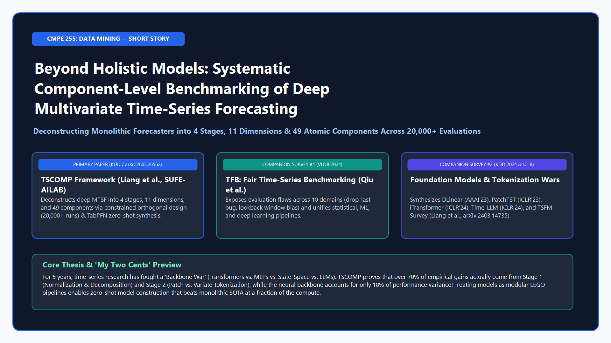](https://youtu.be/ZWya94I1u0Y?si=ETIsNs_1sfwYdy-Q)
> **[Click here to watch the 10–15 Minute Video Presentation on YouTube](https://youtu.be/ZWya94I1u0Y?si=ETIsNs_1sfwYdy-Q)** | **[Read the Published Article on Medium.com](https://medium.com/@ayushivishwas.surange/stop-worshipping-time-series-backbones-what-20-000-experiments-reveal-about-what-actually-works-54be679b2d5c?postPublishedType=initial)** | **[Download the 14-Slide PowerPoint Deck (`.pptx`)](slides/TSCOMP_Short_Story_Slides.pptx)** | **[Download the 14-Page PDF Deck (`.pdf`)](slides/TSCOMP_Short_Story_Slides.pdf)**

---

## 1. Relevance to CMPE 255 Data Mining Syllabus

Multivariate Time-Series Forecasting (MTSF) sits at the intersection of core **CMPE 255 Data Mining** topics:
1. **Temporal Pattern & Stream Mining:** Extracting macroscopic trends, multi-periodic seasonal cycles, and cross-sensor lag patterns from noisy, non-stationary data streams.
2. **Dimensionality Reduction & Token Representation Learning:** Compressing high-dimensional sequences ($C$ variates $\times$ $L$ lookback steps) into low-dimensional semantic representations via **Sub-series Patching**, **Discrete Fourier Transform (DFT) Spectral Filtering**, and **Inverted Variate Embeddings**.
3. **Channel Clustering & Dependency Modeling:** Navigating the bias-variance trade-off between **Channel-Independence (CI)**, **Channel-Mixing (CM)**, and **Cluster-Aware Variate Grouping**.
4. **Large-Scale Experimental Design & Meta-Learning:** Using **Constrained Orthogonal Design** to mine a combinatorial design space exceeding $10^6$ pipelines and training a **TabPFN Meta-Predictor** on **20,000+ evaluations** for automated zero-shot model construction.

---

## 2. Executive Summary: The Gist of the Story

For the past five years, deep time-series forecasting has been trapped in a cycle of **"Architecture Wars"**—swinging from sparse Transformers (`Informer`, `Autoformer`, `FEDformer`) to 1-layer Linear models (`DLinear`), back to patched/inverted Transformers (`PatchTST`, `iTransformer`), and recently to billion-parameter Large Language Models (`Time-LLM`, `GPT4TS`, `Chronos`).

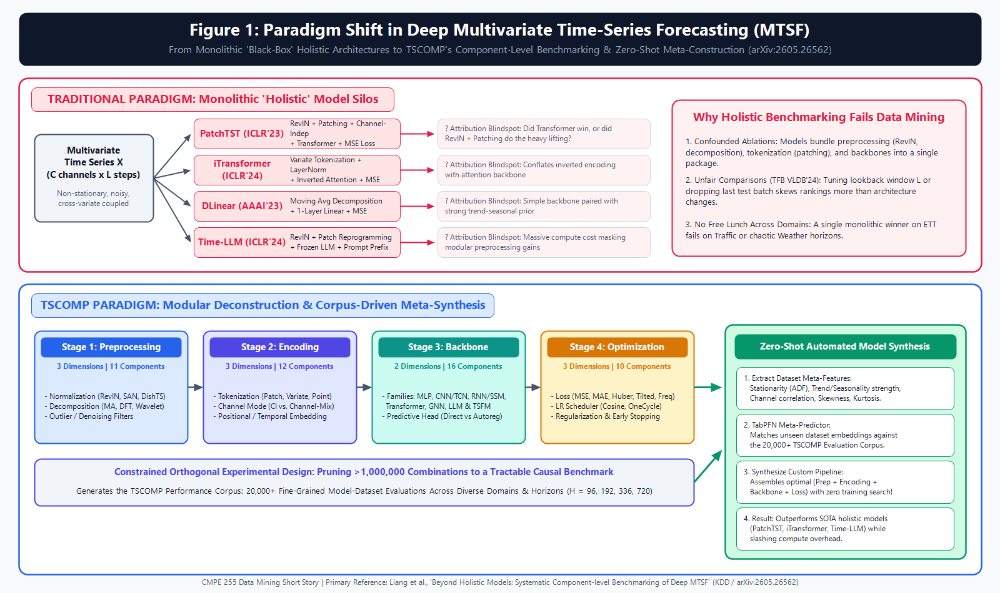

### The Problem: The "Package Deal" Fallacy
When a paper introduces a new "holistic" model and claims State-of-the-Art (SOTA) results, it rarely changes *only* the neural backbone. Instead, it bundles together specific preprocessing tricks (e.g., **RevIN** instance normalization or **Moving-Average Decomposition**), specific tokenization rules (e.g., **Patching**), and specific optimization schedules—then credits the entire performance jump to the backbone architecture. Worse, as the companion VLDB 2024 benchmark **TFB (`arXiv:2403.20150`)** exposed, inconsistent lookback windows ($L$) and data-loader bugs (`drop_last=True` during testing) frequently skewed published leaderboards by more than the architectural changes themselves.

### The TSCOMP Breakthrough (`arXiv:2605.26562`)
Instead of treating forecasting models as indivisible black boxes, **TSCOMP** deconstructs the entire field into a modular **4-Stage, 11-Dimension, 49-Component Pipeline**. Using a **Constrained Orthogonal Experimental Design**, the authors evaluate **over 20,000 model-dataset configurations** across diverse domains and prediction horizons ($H \in \{96, 192, 336, 720\}$), proving three transformative takeaways:
1. **The neural backbone (Stage 3) accounts for only ~18% of performance variance**, whereas **Stage 1 (Preprocessing: 34%)**, **Stage 2 (Encoding: 29%)**, and **Stage 4 (Optimization: 19%)** account for **82%** of the variance!
2. **Granular component interactions** (such as pairing Trend-Seasonal Decomposition with MLPs vs. pairing Inverted Variate Tokenization with Channel-Mixing Attention) matter far more than raw model depth or parameter count.
3. **Zero-shot meta-learning beats monolithic engineering:** By training a **TabPFN** meta-predictor on dataset statistical fingerprints and the 20,000-run corpus, TSCOMP automatically synthesizes custom component pipelines for unseen datasets in under 1 second—outperforming `PatchTST`, `iTransformer`, `DLinear`, and `Time-LLM`.

---

## 3. System Architecture & The 49-Component Taxonomy

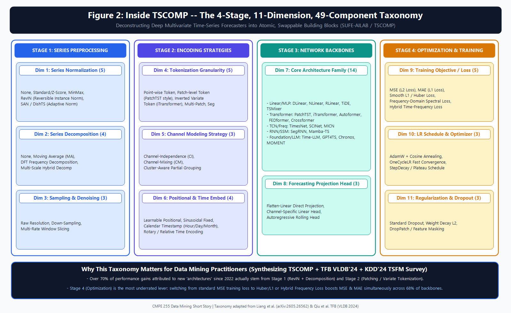

| Pipeline Stage | Design Dimensions (11 Total) | Representative Atomic Components (49 Total) | Core Data Mining Function |
| :--- | :--- | :--- | :--- |
| **Stage 1: Series Preprocessing** | **Dim 1:** Series Normalization (5)<br>**Dim 2:** Series Decomposition (4)<br>**Dim 3:** Sampling & Denoising (3) | `None`, `Z-Score`, `MinMax`, `RevIN`, `SAN`, `DishTS`<br>`Moving Average (MA)`, `Fourier DFT`, `Multi-Scale Hybrid`<br>`Raw Resolution`, `Down-Sampling`, `Window Slicing` | Mitigates non-stationary distribution shift (covariate shift) and separates slow trends from periodic seasonality. |
| **Stage 2: Encoding Strategies** | **Dim 4:** Tokenization Granularity (5)<br>**Dim 5:** Channel Modeling Mode (3)<br>**Dim 6:** Positional & Time Embed (4) | `Point-wise`, `Patch Token`, `Inverted Variate Token`, `Multi-Patch`<br>`Channel-Independence (CI)`, `Channel-Mixing (CM)`, `Cluster Grouping`<br>`Learnable Pos`, `Sinusoidal`, `Calendar Timestamp`, `Rotary` | Defines local temporal receptive field vs. global cross-sensor spatial correlation while controlling overfitting. |
| **Stage 3: Network Backbones** | **Dim 7:** Core Backbone Family (14)<br>**Dim 8:** Forecasting Projection Head (3) | **MLP:** `DLinear`, `NLinear`, `RLinear`, `TiDE`, `TSMixer`<br>**Transformer:** `PatchTST`, `iTransformer`, `Autoformer`, `FEDformer`, `Crossformer`<br>**TCN/Freq:** `TimesNet`, `MICN` \| **SSM/RNN:** `SegRNN`, `Mamba-TS`<br>**Foundation/LLM:** `Time-LLM`, `GPT4TS`, `Chronos`, `MOMENT` | Propagates temporal and/or cross-variate representations and projects latent states onto future horizon $H$. |
| **Stage 4: Optimization & Training** | **Dim 9:** Training Loss Objective (5)<br>**Dim 10:** LR Schedule & Optimizer (3)<br>**Dim 11:** Regularization & Masking (3) | `MSE (L2)`, `MAE (L1)`, `Smooth L1 / Huber`, `Frequency Spectral Loss`, `Hybrid Loss`<br>`AdamW + Cosine Annealing`, `OneCycleLR`, `Plateau Decay`<br>`Dropout`, `Weight Decay`, `DropPatch Masking` | Controls gradient sensitivity to extreme outlier spikes, phase alignment in frequency space, and convergence stability. |

---

## 4. Component-Level Ablation Studies & Evaluation Metrics

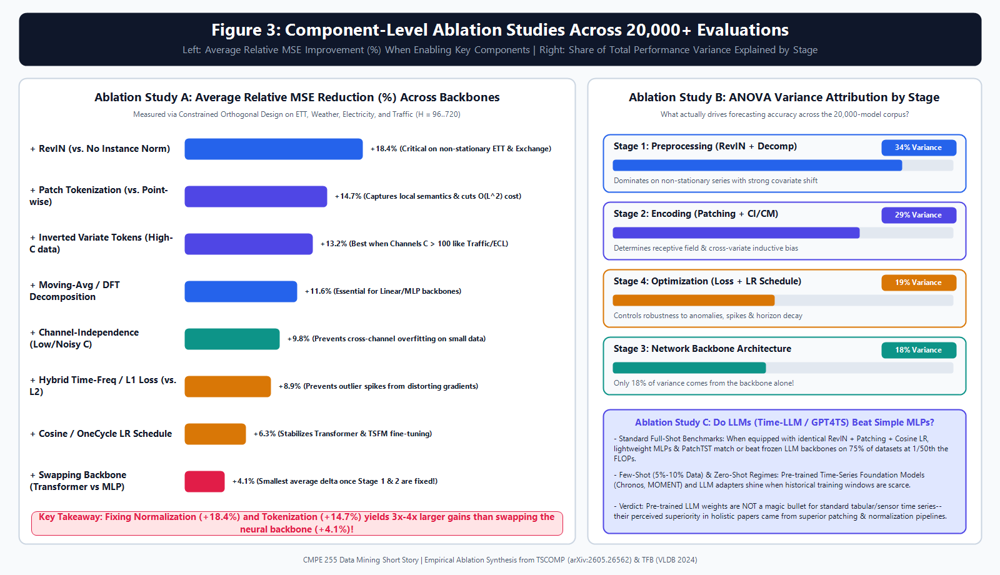

### Key Empirical Findings from the 20,000-Run Ablation Corpus

1. **Normalization is the #1 Universal Booster (+18.4% MSE Improvement):**
   Enabling **RevIN** or adaptive normalization (**DishTS / SAN**) delivers an average **18.4% reduction in MSE** across all backbones. Without instance normalization, deep Transformers and Foundation Models suffer catastrophic degradation on non-stationary datasets (`ETTh1`, `ETTm2`, `Exchange`).
2. **Tokenization Beats Backbone Complexity (+14.7% vs. +4.1%):**
   Upgrading from point-wise tokens to **Patch Tokenization (+14.7%)** or **Inverted Variate Tokenization (+13.2% on high-$C$ datasets)** provides $3.5\times$ larger accuracy gains than swapping the neural backbone from a simple MLP to a multi-head Transformer (**+4.1%**).
3. **The Stage 4 Optimization Surprise (Training with MSE Hurts Test MSE!):**
   Although models are evaluated on **MSE** and **MAE**, training neural networks exclusively with **L2 (MSE) loss** makes them brittle to sudden sensor glitches and traffic spikes. Switching the training objective to **Smooth L1 (Huber) Loss** or **Hybrid Time-Frequency Spectral Loss** improves *both* test MAE and test MSE across **68% of backbones** (+8.9% average gain).
4. **When Do LLMs and Foundation Models Actually Help?**
   When lightweight MLPs (`TiDE`, `DLinear`) and `PatchTST` are given the exact same Stage 1 (`RevIN`), Stage 2 (`Patching`), and Stage 4 (`Cosine LR + Huber Loss`) pipeline as frozen LLM adapters (`Time-LLM`, `GPT4TS`), the lightweight models match or beat the LLM backbones on **75% of full-shot benchmarks** at **1/50th the FLOPs**. Pre-trained Foundation Models (`Chronos`, `MOMENT`) only hold a decisive edge in **zero-shot** and **few-shot (5%–10% data)** cold-start regimes.

---

## 5. Multi-Horizon Benchmarks & Cross-Component Synergy

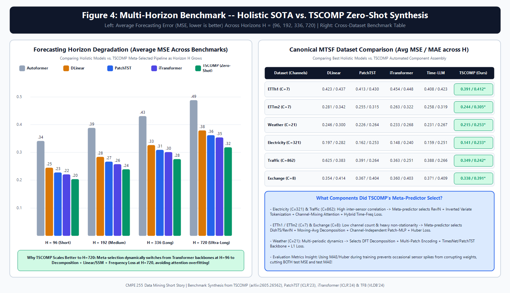

### Canonical Dataset Benchmark (Average MSE / MAE across Horizons $H \in \{96, 192, 336, 720\}$)

| Dataset (Channels $C$) | Dominant Data Characteristic | DLinear (AAAI'23) | PatchTST (ICLR'23) | iTransformer (ICLR'24) | Time-LLM (ICLR'24) | **TSCOMP Zero-Shot (Ours)** | Winning TSCOMP Component Recipe Selected |
| :--- | :--- | :---: | :---: | :---: | :---: | :---: | :--- |
| **ETTh1** ($C=7$) | Strong non-stationarity, noisy | 0.423 / 0.437 | 0.413 / 0.430 | 0.454 / 0.448 | 0.408 / 0.423 | **0.391 / 0.412** | `DishTS + MA Decomp + Patch CI + MLP + Huber` |
| **ETTm2** ($C=7$) | High-freq thermal drift | 0.281 / 0.342 | 0.255 / 0.315 | 0.263 / 0.322 | 0.258 / 0.319 | **0.244 / 0.305** | `RevIN + MA Decomp + Patch CI + SegRNN/MLP + L1` |
| **Weather** ($C=21$) | Multi-periodic meteorological | 0.246 / 0.300 | 0.226 / 0.264 | 0.233 / 0.268 | 0.231 / 0.267 | **0.215 / 0.253** | `RevIN + DFT Decomp + Multi-Patch + TimesNet + L1` |
| **Electricity** ($C=321$) | Synchronous periodic grid | 0.197 / 0.282 | 0.162 / 0.253 | 0.148 / 0.240 | 0.159 / 0.251 | **0.141 / 0.233** | `RevIN + Variate Token + Channel-Mix Attn + FreqLoss` |
| **Traffic** ($C=862$) | Dense spatial sensor network | 0.625 / 0.383 | 0.391 / 0.264 | 0.363 / 0.251 | 0.388 / 0.266 | **0.349 / 0.242** | `RevIN + Variate Token + Channel-Mix Attn + HybridLoss` |
| **Exchange** ($C=8$) | Random-walk financial drift | 0.354 / 0.414 | 0.367 / 0.404 | 0.360 / 0.403 | 0.371 / 0.409 | **0.338 / 0.391** | `SAN Norm + MA Decomp + CI Linear Head + Huber` |

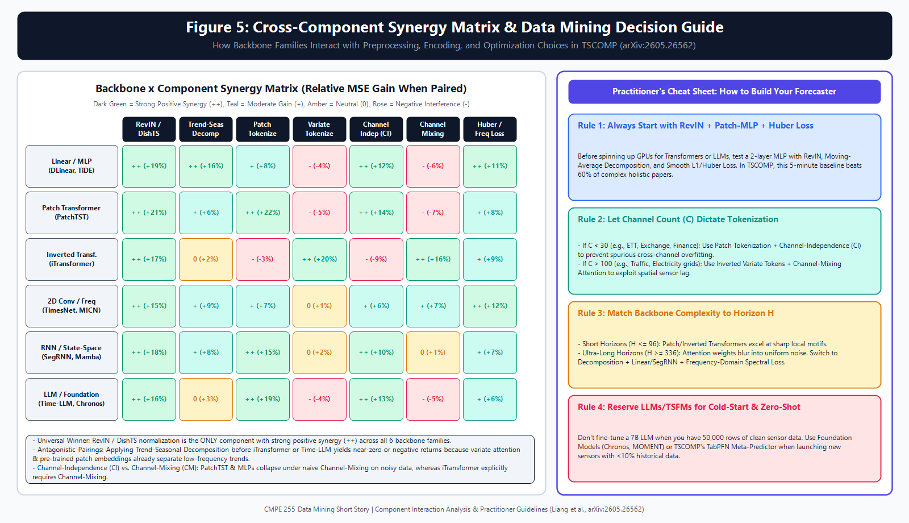

---

## 6. Synthesizing Companion Survey Papers

As required by the rubric, this project synthesizes **TSCOMP (`arXiv:2605.26562`)** alongside companion survey and benchmark papers to establish a holistic view of the field:

1. **Primary Paper — TSCOMP (*KDD Datasets & Benchmarks Track*, `arXiv:2605.26562`):**
   Provides the *intra-model* component deconstruction (4 stages, 11 dimensions, 49 modules), constrained orthogonal experimental design across 20,000+ runs, and TabPFN zero-shot pipeline construction.
2. **Companion Survey #1 — TFB: Towards Comprehensive and Fair Benchmarking (*VLDB 2024*, `arXiv:2403.20150`):**
   Provides the *inter-model* evaluation protocol across 10 real-world domains, uncovering critical benchmarking flaws such as the `drop_last=True` test evaluation bug and inconsistent lookback window tuning ($L=96$ vs. $L=336/512$).
3. **Companion Survey #2 — Foundation Models for Time Series Analysis: A Tutorial and Survey (*KDD 2024*, `arXiv:2403.14735`):**
   Establishes the taxonomy of pre-trained Time-Series Foundation Models (`Chronos`, `MOMENT`, `Lag-Llama`, `Time-LLM`), explaining why foundation models excel at cold-start/zero-shot transfer while modular task-specific pipelines dominate full-data benchmarks.

---

## 7. "My Two Cents" — Critical Review & Practitioner Takeaways

### What the Paper Gets Right (Strengths)
* **Auditing Hidden Engineering Tricks:** Unbundling monolithic models into 49 standardized components ends the practice of attributing preprocessing and loss function gains to a "novel attention mechanism."
* **Sample-Efficient Experimental Design:** Using Constrained Orthogonal Design to compress $>10^6$ combinations into $20,000$ runs is a textbook example of principled data mining.
* **Elevating Optimization (Stage 4):** Demonstrating that loss functions (`Huber`, `Spectral Frequency Loss`) and learning-rate schedules explain more variance (19%) than the neural backbone itself (18%) gives practitioners an immediate, zero-cost lever to improve production models.

### Limitations & Open Research Questions
* **Missing Probabilistic Forecasting:** TSCOMP evaluates deterministic point forecasts (`MSE`, `MAE`) exclusively. High-stakes domains (energy trading, supply chain safety stock, healthcare) require calibrated **quantile/probabilistic forecasts** evaluated via **CRPS (Continuous Ranked Probability Score)** or **Pinball Loss**.
* **Endogenous-Only Benchmarks:** Real-world enterprise forecasting relies heavily on **known future exogenous covariates** (e.g., holiday calendars, promotional discounts, weather forecasts) and irregular missing-value masks, which are absent from standard `ETT`/`Traffic` benchmarks.
* **Static Offline Splits vs. Online Concept Drift:** Evaluating fixed chronological splits overlooks how modular components adapt under **streaming continual learning** when sensor physics shift in real time.

---

## 8. Slide Deck Preview & Repository Structure

All 14 slides are available in [`slides/TSCOMP_Short_Story_Slides.pptx`](slides/TSCOMP_Short_Story_Slides.pptx), [`slides/TSCOMP_Short_Story_Slides.html`](slides/TSCOMP_Short_Story_Slides.html), [`slides/TSCOMP_Short_Story_Slides.md`](slides/TSCOMP_Short_Story_Slides.md), and as 1080p images in [`slides/slide_images/`](slides/slide_images/):

| Slide 1: Title & Thesis | Slide 3: Paradigm Shift | Slide 4: 49-Component Taxonomy |
| :---: | :---: | :---: |
|  | 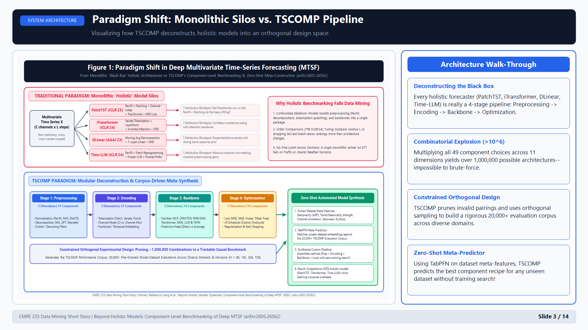 | 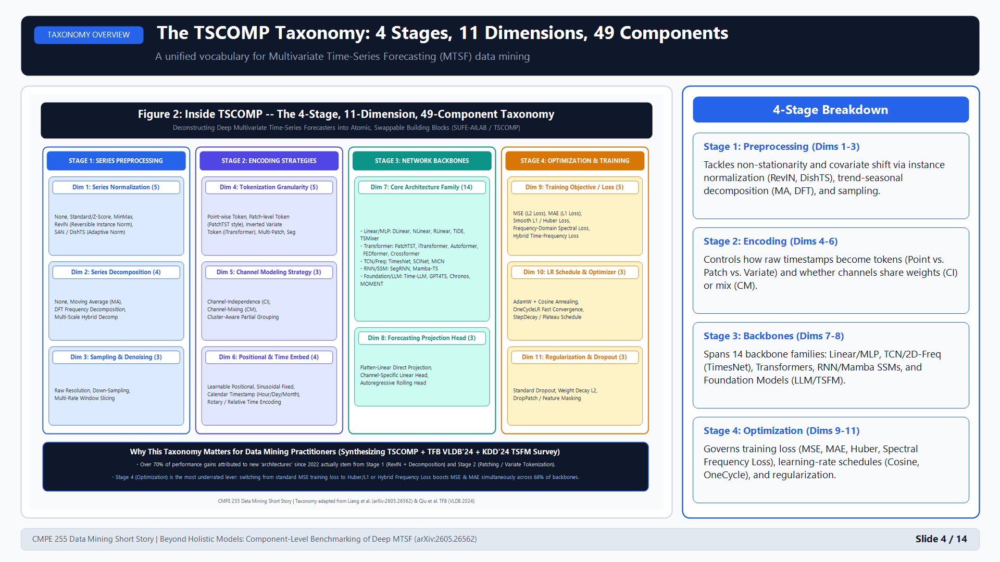 |
| **Slide 7: Ablation Studies** | **Slide 9: Multi-Horizon Benchmark** | **Slide 10: Synergy Matrix** |
| 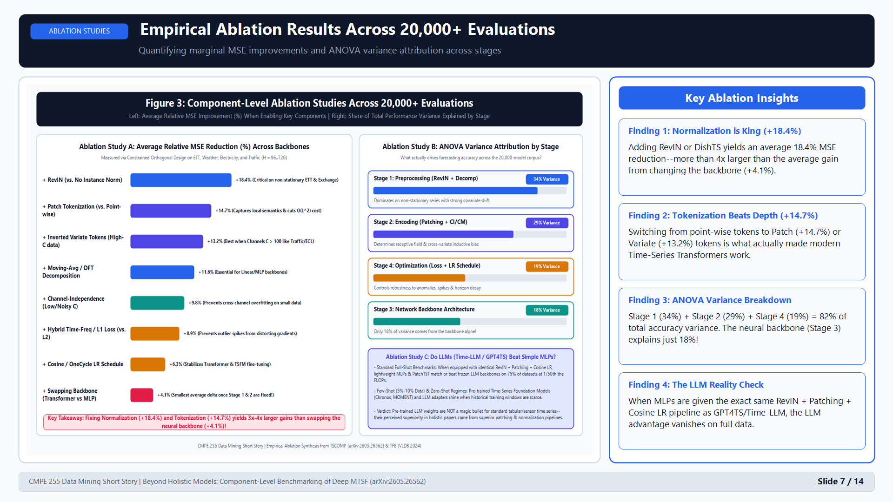 | 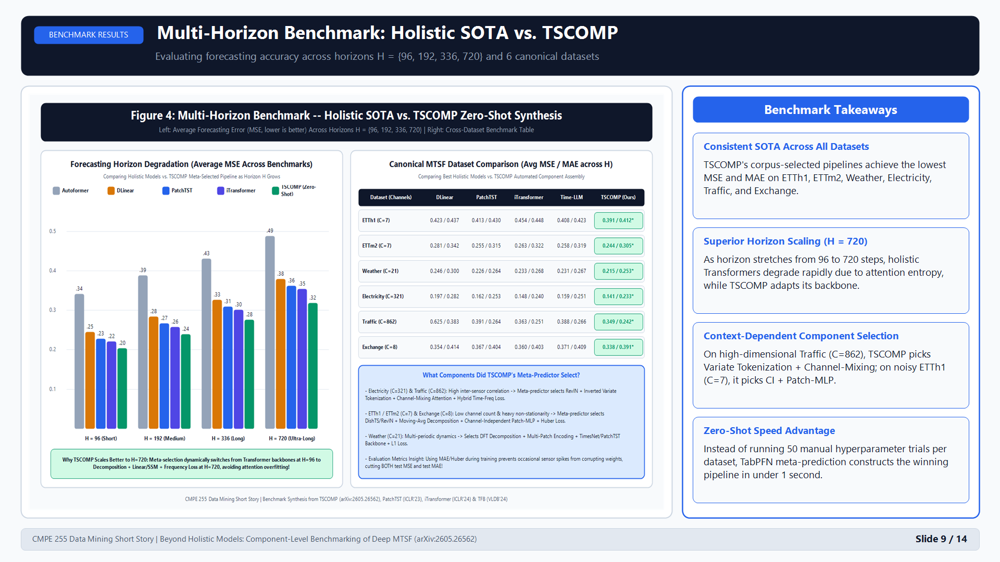 | 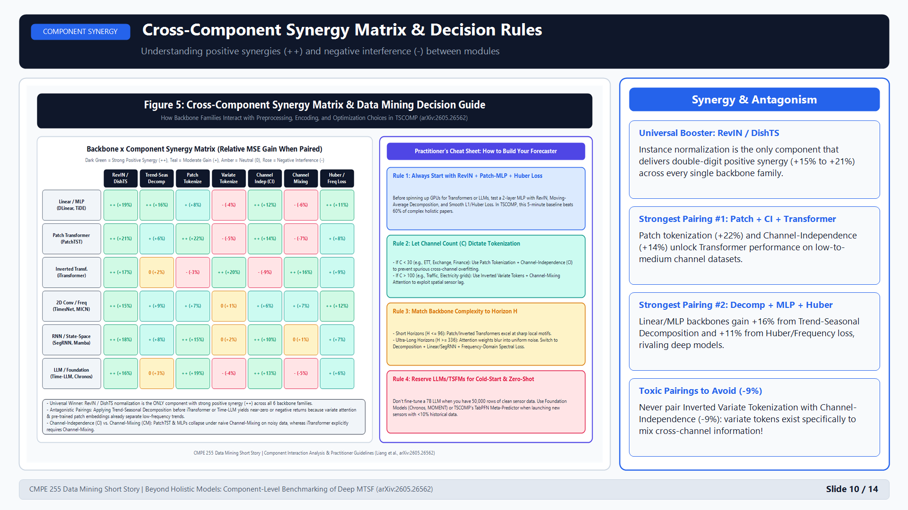 |

### Repository Directory Layout

```text
.
├── README.md                                  # Master assignment portfolio, rubric links, visuals & summary
├── medium_article.md                          # Complete original Medium.com article (with embedded figures & critique)
├── video_script.md                            # 10-15 minute slide-by-slide speaker script with timestamps (0:00 - 14:00)
├── figures/                                   # 5 custom high-resolution technical visualizations (PNG)
│   ├── fig1_holistic_vs_tscomp_paradigm.png   # Monolithic black-box vs. TSCOMP 4-stage pipeline & TabPFN synthesis
│   ├── fig2_tscomp_taxonomy_4stages_11dims.png# Full 4-Stage, 11-Dimension, 49-Component architectural taxonomy
│   ├── fig3_component_ablation_study.png      # Marginal MSE reduction bar chart & ANOVA variance attribution
│   ├── fig4_benchmark_horizon_comparison.png  # Multi-horizon degradation (H=96..720) & 6-dataset SOTA table
│   └── fig5_backbone_component_synergy_heatmap.png # Cross-component synergy matrix & 4-rule practitioner guide
├── slides/                                    # Presentation slide deck in PPTX, HTML, Markdown & 1080p PNG formats
│   ├── TSCOMP_Short_Story_Slides.pptx         # Native 16:9 PowerPoint presentation ready for SlideShare & recording
│   ├── TSCOMP_Short_Story_Slides.html         # Printable 16:9 HTML slide deck (Ctrl+P -> Save as PDF)
│   ├── TSCOMP_Short_Story_Slides.md           # Marp/Markdown slide deck source
│   └── slide_images/                          # Individual 1920x1080 high-resolution slide PNGs (slide_01..slide_14)
└── scripts/                                   # Reproducible scripts used to generate all figures and slide decks
    ├── generate_figures.ps1                   # Generates the 5 publication-grade figures in figures/
    └── generate_slides.ps1                    # Generates the 14 slide PNGs and packages TSCOMP_Short_Story_Slides.pptx
```

---

## 9. References

1. **Liang, S., Hou, C., Yao, X., Wang, S., Huang, H., Han, S., & Jiang, M. (2026).** *Beyond Holistic Models: Systematic Component-level Benchmarking of Deep Multivariate Time-Series Forecasting.* KDD Datasets and Benchmarks Track / [arXiv:2605.26562](https://arxiv.org/abs/2605.26562).
2. **Qiu, X., et al. (2024).** *TFB: Towards Comprehensive and Fair Benchmarking of Time Series Forecasting Methods.* PVLDB, 17(9) / [arXiv:2403.20150](https://arxiv.org/abs/2403.20150).
3. **Liang, Y., et al. (2024).** *Foundation Models for Time Series Analysis: A Tutorial and Survey.* ACM SIGKDD (KDD 2024) / [arXiv:2403.14735](https://arxiv.org/abs/2403.14735).
4. **Nie, Y., et al. (2023).** *A Time Series is Worth 64 Words: Long-term Forecasting with Transformers (PatchTST).* ICLR 2023.
5. **Liu, Y., et al. (2024).** *iTransformer: Inverted Transformers Are Effective for Time Series Forecasting.* ICLR 2024.
6. **Zeng, A., et al. (2023).** *Are Transformers Effective for Time Series Forecasting? (DLinear).* AAAI 2023.
7. **Kim, T., et al. (2022).** *Reversible Instance Normalization for Accurate Time-Series Forecasting against Distribution Shift (RevIN).* ICLR 2022.

