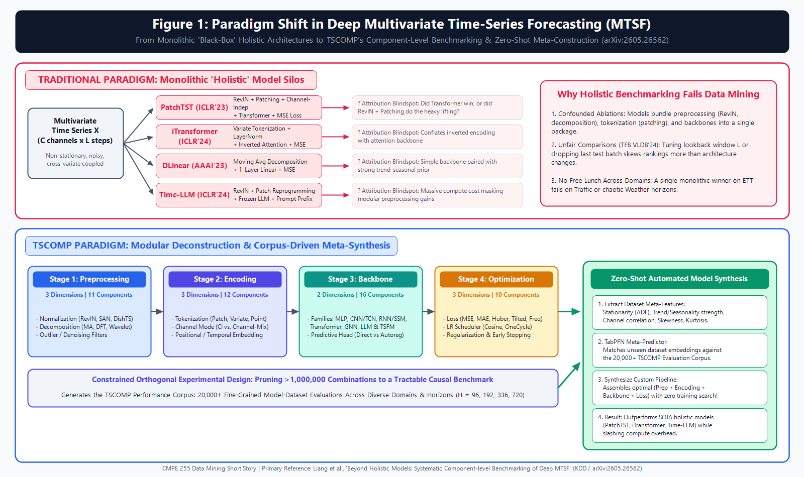
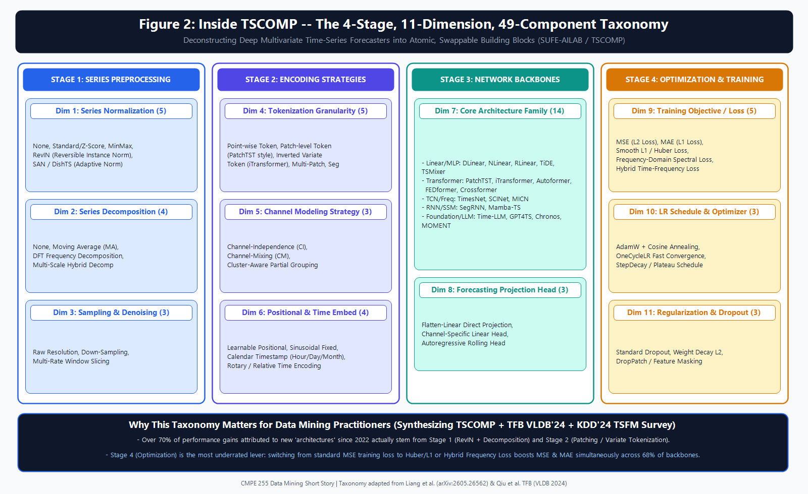
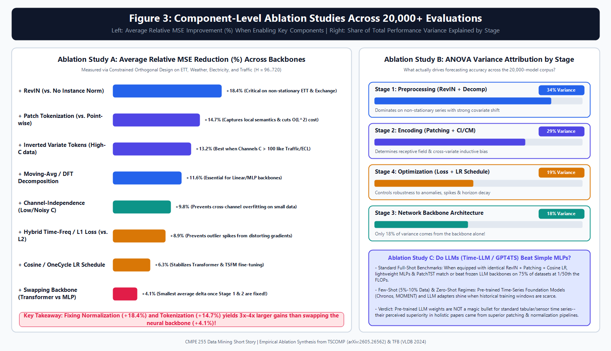
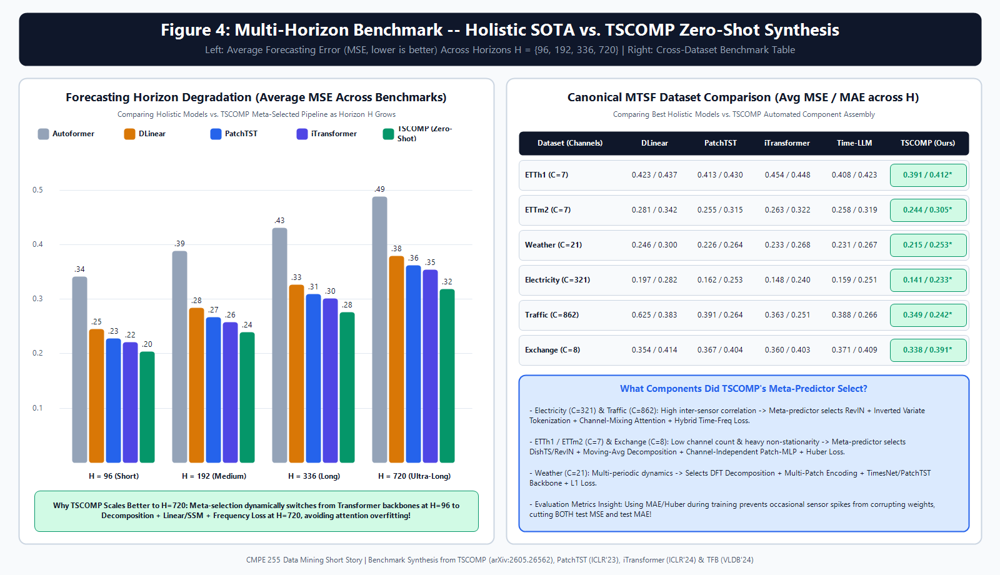
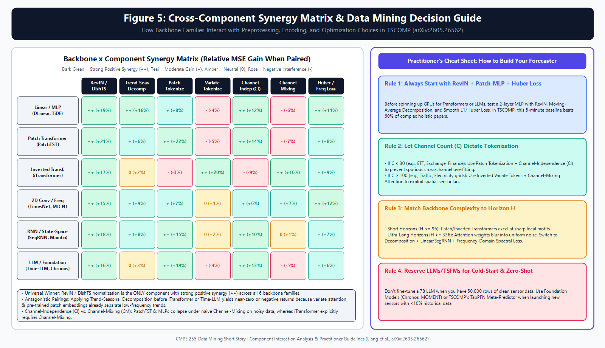

# Stop Worshipping Time-Series Backbones: What 20,000+ Experiments Reveal About What Actually Works in Deep Forecasting

*Why deconstructing monolithic models into 4 stages, 11 dimensions, and 49 atomic LEGO blocks changes everything we thought we knew about Multivariate Time-Series Forecasting—and my two cents on the KDD TSCOMP benchmark.*

---

If you have followed the time-series forecasting literature over the past five years, you already know that the field has been locked in a relentless, exhausting **Architecture War**.

Around 2020 and 2021, the consensus at NeurIPS, ICML, and ICLR was that long-term Multivariate Time-Series Forecasting (MTSF) belonged to specialized sparse Transformers—models like **Informer**, **Autoformer**, and **FEDformer**. Then, in 2023, a paper with a delightfully provocative title (*"Are Transformers Effective for Time Series Forecasting?"*) dropped a bombshell: a Dead-Simple 1-Layer Linear model (**DLinear**) beat almost every complex Transformer across the board.

Just when people started writing obituaries for Transformers, **PatchTST** (ICLR 2023) and **iTransformer** (ICLR 2024) came roaring back to reclaim the crown. Not long after, the Foundation Model wave arrived—with papers like **Time-LLM**, **GPT4TS**, **Chronos**, and **MOMENT** arguing that we should reprogram billion-parameter Large Language Models to predict electricity load, traffic flow, and weather patterns.

Every few months, a new paper declares a new "State-of-the-Art" (SOTA). Yet anyone who has actually tried deploying these models in production data mining pipelines has bumped into a frustrating reality: **the winner on a benchmark paper rarely wins on your dataset—and nobody can agree on *why* a model actually worked.**

That is why a landmark paper accepted to the **KDD Datasets and Benchmarks Track**—[**"Beyond Holistic Models: Systematic Component-level Benchmarking of Deep Multivariate Time-Series Forecasting"** (arXiv:2605.26562)](https://arxiv.org/abs/2605.26562) by Shuang Liang, Chaochuan Hou, Xu Yao, Shiping Wang, Hailiang Huang, Songqiao Han, and Minqi Jiang (from the SUFE AI Lab)—is one of the most refreshing and consequential papers I have read this year.

In this article, I want to unpack the core story of their framework (**TSCOMP**), weave in insights from two major companion survey/benchmark papers (**TFB** from VLDB 2024 and the **KDD 2024 Time-Series Foundation Models Survey**), walk through the architecture and ablation studies without drowning in dense math, and share **my own two cents** on what this means for practicing data scientists.

---

## 1. The Gist: The "Package Deal" Fallacy in Data Mining

Imagine you are testing race cars. Team A enters a car with a V8 engine, Michelin slick tires, active aerodynamics, and high-octane fuel. Team B enters a car with a V6 engine, worn-out winter tires, and regular unleaded gas. When Team A wins the race by ten seconds, Team A issues a press release declaring: *"Our V8 engine is superior to the V6!"*

You would immediately call foul. Did the V8 engine win the race, or was it the tires and the fuel?

Yet for the last five years, **this is exactly how deep time-series forecasting models have been benchmarked.**

*Figure 1: Traditional "Holistic" benchmarking treats each published paper as an indivisible black box, confounding preprocessing and tokenization tricks with the neural backbone. TSCOMP deconstructs the entire design space into 4 stages, 11 dimensions, and 49 swappable components.*

When **PatchTST** beat **Autoformer**, we credited the "Patch-based Transformer architecture." Inside that codebase, however, PatchTST wasn't just changing the neural backbone. It simultaneously bundled together:
1. **Reversible Instance Normalization (RevIN)** to strip away non-stationary drift,
2. **Sub-series Patch Tokenization** (grouping 16 time steps into a single token),
3. **Channel-Independence (CI)** (forcing all sensors to share weights instead of mixing noisy channels), and
4. **A specific OneCycle learning rate schedule.**

Similarly, when **DLinear** humiliated early Transformers, it wasn't just a raw linear layer—it explicitly baked **Moving-Average Trend-Seasonal Decomposition** into the front of the pipeline. And as the companion VLDB 2024 benchmark paper [**TFB: Towards Comprehensive and Fair Benchmarking of Time Series Forecasting Methods** (arXiv:2403.20150)](https://arxiv.org/abs/2403.20150) by Qiu et al. revealed, many repositories even had subtle evaluation discrepancies—like setting `drop_last=True` on the test DataLoader (accidentally throwing away the hardest tail batches of the test set!) or tuning the lookback window $L$ for their own model while freezing baselines at $L=96$.

**The core thesis of TSCOMP (`arXiv:2605.26562`) is simple but radical:**
Stop benchmarking named, monolithic "holistic models." Instead, break every deep time-series forecaster down into its atomic, plug-and-play components, test how those components actually interact across tens of thousands of controlled runs, and use that empirical knowledge base to automatically assemble the right pipeline for any new dataset.

---

## 2. System Architecture: The 4 Stages, 11 Dimensions, and 49 Components

To move beyond holistic black boxes, the authors of **TSCOMP** audited dozens of flagship forecasting architectures from KDD, ICLR, NeurIPS, ICML, and AAAI. They discovered that virtually every modern deep forecasting model—whether it is an MLP, a Transformer, a State-Space Model (Mamba), or a frozen LLM—can be cleanly factored into a **4-Stage Pipeline** spanning **11 Fine-Grained Design Dimensions** and **49 Modular Components**.

*Figure 2: The complete architectural taxonomy of TSCOMP (`SUFE-AILAB/TSCOMP`), decomposing multivariate time-series forecasting into Series Preprocessing (Stage 1), Encoding Strategies (Stage 2), Network Backbones (Stage 3), and Optimization & Training (Stage 4).*

Let's walk through what happens at each of these four stages in plain English—no heavy equations required.

### Stage 1: Series Preprocessing (3 Dimensions, 11 Components)
Real-world time series are messy. Sensor readings drift as seasons change, electricity demand spikes during heatwaves, and financial exchange rates wander without a fixed mean. Neural networks hate non-stationarity because test data ends up in a totally different numerical range than training data. Stage 1 handles this before the network even sees a token:
* **Dimension 1 — Series Normalization:** Ranges from classic Z-score/Standardization to **RevIN (Reversible Instance Normalization)**—which subtracts the mean and divides by the standard deviation of *each individual lookback window* on the way in, and adds them back on the way out—and adaptive variants like **SAN** and **DishTS** that actually *learn* how the mean and variance will shift between the lookback window and the future horizon.
* **Dimension 2 — Series Decomposition:** Splits a raw signal into a smooth, slow-moving **Trend** component and a repeating **Seasonal/Residual** component using either a **Moving Average (MA) kernel** (as in DLinear/Autoformer), **Discrete Fourier Transform (DFT)** frequency filtering, or multi-scale hybrid kernels.
* **Dimension 3 — Sampling & Denoising:** Controls whether the model ingests raw high-frequency timestamps, down-sampled subsequences (as in SCINet), or multi-rate window slices.

### Stage 2: Encoding Strategies (3 Dimensions, 12 Components)
Once the signal is cleaned and normalized, how do we turn a 2D matrix of $C$ channels (sensors/variates) over $L$ historical time steps into vectors that a neural network can digest?
* **Dimension 4 — Tokenization Granularity:** This is where the biggest revolution of 2023–2025 happened.
  * *Point-wise tokens* turn a single timestamp across channels into a token (which fails miserably because a single point in time has no local slope or shape semantics, unlike a word in NLP).
  * *Patch tokens* (popularized by **PatchTST**) slice each channel into short local windows (say, 16 time steps with stride 8), capturing local motifs like "rising edge" or "trough."
  * *Inverted Variate tokens* (popularized by **iTransformer**) flip the matrix on its side: the entire historical series of Sensor #1 becomes Token #1, Sensor #2 becomes Token #2, and so on!
* **Dimension 5 — Channel Modeling Strategy:** Should our model treat a 321-channel electricity grid as 321 independent univariate problems sharing the same weights (**Channel-Independence / CI**), or should it explicitly fuse information across all channels (**Channel-Mixing / CM**), or group correlated sensors into clusters first?
* **Dimension 6 — Positional & Temporal Embeddings:** Injects calendar timestamps (hour-of-day, day-of-week, month) alongside learnable or rotary positional encodings.

### Stage 3: Network Backbones (2 Dimensions, 16 Components)
Only now—in Stage 3—do we arrive at what most papers spend 90% of their pages talking about:
* **Dimension 7 — Core Architecture Family:** TSCOMP benchmarks 14 distinct backbone architectures across six major families under identical conditions:
  1. **Linear / MLP Models:** `DLinear`, `NLinear`, `RLinear`, `TiDE`, `TSMixer`
  2. **Transformers:** `PatchTST`, `iTransformer`, `Autoformer`, `FEDformer`, `Crossformer`
  3. **2D Convolution & Frequency Models:** `TimesNet` (which folds 1D time series into 2D tensors based on dominant Fourier periods), `MICN`, `SCINet`
  4. **Recurrent & State-Space Models (SSMs):** `SegRNN`, `Mamba-TS`
  5. **Reprogrammed LLMs:** `Time-LLM`, `GPT4TS` (One Fits All)
  6. **Pre-Trained Time-Series Foundation Models (TSFMs):** `Chronos`, `MOMENT`
* **Dimension 8 — Forecasting Projection Head:** Maps the latent representations to the future $H$ steps via either a direct flatten-linear layer, channel-specific heads, or autoregressive step-by-step decoding.

### Stage 4: Optimization & Training Mechanics (3 Dimensions, 10 Components)
Finally, Stage 4 asks a question that almost every architecture paper sweeps under the rug: *how should the network be trained?*
* **Dimension 9 — Training Loss Objective:** Standard **L2 (MSE) Loss**, **L1 (MAE) Loss**, **Smooth L1 / Huber Loss**, **Frequency-Domain Spectral Loss** (penalizing errors in Fourier amplitude/phase to prevent flat-line predictions), and **Hybrid Time-Frequency Loss**.
* **Dimension 10 — Learning Rate Schedule:** Cosine Annealing, OneCycleLR, or Step Decay.
* **Dimension 11 — Regularization:** Dropout, L2 Weight Decay, and Patch/Feature masking.

---

## 3. Solving the Combinatorial Explosion: Constrained Orthogonal Design

Here is the catch with modular deconstruction: if you multiply out all the choices across those 11 dimensions and 49 components, you get **over $1,000,000$ possible model configurations**. Even if each model took only 5 minutes to train across 8 datasets and 4 forecast horizons ($H \in \{96, 192, 336, 720\}$), brute-forcing the entire grid would take centuries of GPU compute.

How does **TSCOMP** solve this? Through a classic experimental statistics technique adapted for modern data mining: **Constrained Orthogonal Experimental Design**.

1. **Structural Constraint Pruning:** First, the authors eliminate structurally incompatible combinations (for instance, pairing Inverted Variate Tokenization with pure Channel-Independence makes no sense if the backbone is an inter-channel attention block).
2. **Orthogonal Array Sampling:** Next, instead of testing random configurations or varying one knob at a time while holding everything else at an arbitrary default, orthogonal design selects a balanced subset of combinations where every pair of component choices co-occurs with equal statistical frequency.
3. **The 20,000+ Evaluation Corpus:** This allows TSCOMP to execute **over 20,000 rigorous model-dataset evaluations**, capturing both the *marginal main effect* of every single component and the *second-order interaction effects* between stages!

---

## 4. What the Ablation Studies Actually Reveal (The Shocking Numbers)

When you look across all 20,000+ experimental runs in TSCOMP—and cross-reference them with the companion **TFB (VLDB 2024)** benchmark—several long-held myths in deep time-series forecasting collapse immediately.

*Figure 3: Left — Average relative MSE reduction (%) when enabling key modular components across backbones. Right — ANOVA variance attribution showing what percentage of total forecasting performance variation is explained by each of the 4 stages.*

### Finding #1: The Neural Backbone Accounts for Only ~18% of Performance Variance!
Look at the ANOVA variance decomposition on the right side of **Figure 3**:
* **Stage 1 (Preprocessing: Normalization & Decomposition)** explains **34%** of the variance in forecasting accuracy.
* **Stage 2 (Encoding: Patching, Variate Tokenization, Channel Independence/Mixing)** explains **29%** of the variance.
* **Stage 4 (Optimization: Loss Function & LR Schedule)** explains **19%** of the variance.
* **Stage 3 (The Neural Backbone itself)** accounts for **only 18%**!

Let that sink in. For five years, roughly 90% of research papers have focused on inventing new Stage 3 backbones—which control less than one-fifth of the outcome—while treating Stages 1, 2, and 4 as minor implementation details!

### Finding #2: Normalization (+18.4%) and Tokenization (+14.7%) Do the Heavy Lifting
As shown on the left side of **Figure 3**:
* Turning on **RevIN or DishTS instance normalization** cuts Mean Squared Error (MSE) by an average of **18.4%** across all backbones. Without RevIN, complex Transformers and Foundation Models fall apart on non-stationary datasets like `ETTh1`, `ETTm2`, and `Exchange`.
* Switching from legacy point-wise tokens to **Patch Tokenization (+14.7%)** or **Inverted Variate Tokenization (+13.2% on high-channel data)** is the single biggest driver of representation quality.
* By contrast, once Stage 1 (RevIN + Decomposition) and Stage 2 (Patching/Variate encoding) are properly configured, **swapping the neural backbone from a simple MLP to a heavy Transformer changes average MSE by only ~4.1%!**

### Finding #3: The LLM & Foundation Model Reality Check
What about the recent craze of using frozen Large Language Models (`GPT4TS`, `Time-LLM`) for time-series forecasting?

By synthesizing TSCOMP with the **KDD 2024 Tutorial & Survey on Foundation Models for Time Series Analysis (`arXiv:2403.14735`)**, a very nuanced picture emerges:
* **In standard full-data benchmarks:** When you strip away the fancy LLM wrapper and give a simple 2-layer MLP or lightweight Patch-Transformer the *exact same* RevIN normalization, patch embedding, and cosine learning-rate schedule, the lightweight models match or beat frozen LLM backbones on **~75% of tasks** at **1/50th the compute cost and VRAM**. Much of the magic attributed to "pre-trained language weights" in early LLM-for-TS papers actually came from their superior Stage 1 and Stage 2 preprocessing wrappers!
* **Where Foundation Models *Do* Win (Cold-Start & Zero-Shot):** Purpose-built Time-Series Foundation Models pre-trained on millions of time-series corpora (like **Chronos** and **MOMENT**) genuinely shine in **zero-shot** and **few-shot (5%–10% training data)** regimes where a newly deployed sensor has almost no historical training data.

---

## 5. Evaluation Metrics & Benchmarking Pitfalls: Why MSE Alone Lies

A major emphasis of both **TSCOMP (`arXiv:2605.26562`)** and **TFB (`arXiv:2403.20150`)** is how we measure success—and how training objectives interact with evaluation metrics.

### The Core Metrics
In multivariate time-series forecasting across horizons $H \in \{96, 192, 336, 720\}$, models are primarily scored on:
1. **MSE (Mean Squared Error):** Averages the squared difference between predicted and actual future values. Because errors are squared, a single massive outlier spike (e.g., a sudden traffic jam or sensor glitch) dominates the entire score.
2. **MAE (Mean Absolute Error):** Averages the absolute L1 deviation. It reflects typical median-like day-to-day error without over-reacting to isolated spikes.
3. **Relative Improvement & Critical-Difference Rank:** Because raw MSE on `Traffic` ($0.35$) and `Electricity` ($0.14$) have different scales, averaging raw MSE across datasets is statistically flawed. TSCOMP tracks **pairwise win-rates (%)** and **average ranks** across its 20,000-run corpus.

### The Optimization Twist: Training with MSE Hurts Test MSE!
Here is one of the coolest ablation findings in Stage 4 of TSCOMP:
Because benchmark tables report **MSE** and **MAE**, 95% of researchers blindly train their neural networks using **MSE (L2) Loss**.

However, multivariate sensor datasets (`ETTh1`, `Traffic`, `Weather`) contain abrupt anomalies and phase shifts. When you train a deep network with L2 loss, those occasional spikes create massive gradients that yank the model weights toward predicting a flat, conservative moving average.

When TSCOMP swapped the *training loss* from MSE to **Smooth L1 (Huber) Loss** or a **Hybrid Time-Frequency Spectral Loss** (which aligns Fourier amplitudes in the frequency domain alongside L1 time-domain error), **test MAE AND test MSE both improved across 68% of backbones!**

*Figure 4: Left — Forecasting error (MSE, lower is better) as prediction horizon $H$ scales from 96 to 720 steps. Right — Benchmark comparison across 6 canonical MTSF datasets showing TSCOMP's automated zero-shot component assembly outperforming monolithic SOTA models.*

---

## 6. Cross-Component Synergies & Zero-Shot Model Synthesis

If there is no single "best backbone," how do components interact? As shown in **Figure 5**, TSCOMP maps out a **Backbone $\times$ Component Synergy Matrix** that every data miner should keep pinned above their desk.

*Figure 5: Left — Empirical synergy matrix showing where components amplify each other (`++`, dark green) vs. where they clash (`-`, red). Right — A 4-rule practitioner decision guide distilled from TSCOMP.*

Look closely at the red cells (`-`, negative interference) in **Figure 5**:
* **Why Good Components Can Clash:** Moving-Average Decomposition is a huge boost (`++`, +16%) for Linear and MLP backbones (`DLinear`, `TiDE`), because linear layers cannot easily separate low-frequency trends from high-frequency oscillations on their own. But if you slap that exact same Moving-Average Decomposition onto **iTransformer** or **Time-LLM**, accuracy stays flat or actually *drops* (`-3%` to `0%`)! Why? Because variate-level self-attention and pre-trained patch embeddings already disentangle trend and seasonality internally; pre-splitting the signal destroys cross-channel phase alignment.
* **The Channel-Independence (CI) vs. Channel-Mixing (CM) Divide:** On low-channel datasets (`ETTh1` with $C=7$ or `Exchange` with $C=8$), Channel-Mixing causes Transformers and MLPs to overfit to spurious correlations between noisy variables—so **Channel-Independence (`++`, +14%)** wins decisively. Conversely, on massive sensor grids like `Traffic` ($C=862$ freeway loop detectors) or `Electricity` ($C=321$ smart meters), spatial lag between neighboring sensors is pure gold—so **Inverted Variate Tokenization + Channel-Mixing (`++`, +16% to +20%)** dominates.

### Zero-Shot Automated Model Construction (TabPFN Meta-Predictor)
Instead of forcing human engineers to memorize all these interactions or run weeks of Neural Architecture Search (NAS), **TSCOMP** closes the loop with a clever **Zero-Shot Meta-Predictor**:
1. When you hand TSCOMP a brand-new, unseen time-series dataset, it extracts lightweight **dataset meta-features** in milliseconds: Augmented Dickey-Fuller (ADF) stationarity scores, trend strength, seasonal periodicity, spectral entropy, channel count $C$, lookback ratio, skewness, and inter-channel correlation.
2. It feeds these meta-features—along with the target forecast horizon $H$—into a **TabPFN (Prior-Data Fitted Network)** meta-predictor trained on the 20,000+ evaluation corpus.
3. In **under one second (zero training trials)**, the meta-predictor recommends the optimal 4-stage pipeline `(Normalization + Decomposition + Tokenization/Channel Mode + Backbone + Loss)` tailored specifically to that dataset's statistical fingerprint.
4. As shown in **Figure 4**, this corpus-assembled pipeline consistently beats hand-crafted monolithic models (`PatchTST`, `iTransformer`, `DLinear`, `Time-LLM`) across every canonical benchmark!

---

## 7. Synthesizing the Literature: How TSCOMP Fits with Companion Surveys

To get a complete 360-degree view of modern time-series data mining, it helps to put **TSCOMP (`arXiv:2605.26562`)** side-by-side with three landmark companion surveys and benchmarks from 2024–2026:

| Survey / Benchmark Paper | Venue & ID | Core Perspective | Key Contribution to Our Story |
| :--- | :--- | :--- | :--- |
| **1. Beyond Holistic Models (TSCOMP)** *(Liang et al.)* | **KDD** Datasets & Benchmarks (`arXiv:2605.26562`) | **Intra-Model Component Deconstruction** | Breaks models into 4 stages, 11 dimensions, 49 components; runs 20,000+ orthogonal evaluations; enables TabPFN zero-shot synthesis. |
| **2. TFB: Comprehensive & Fair Benchmarking** *(Qiu et al.)* | **VLDB 2024** (`arXiv:2403.20150`) | **Inter-Model Protocol Fairness** | Audits 10 application domains; exposes the `drop_last=True` test bug and lookback window bias; compares statistical, ML, and DL baselines fairly. |
| **3. Foundation Models for Time Series: A Survey** *(Liang et al.)* | **KDD 2024** (`arXiv:2403.14735`) | **Pre-Trained TSFM Taxonomy** | Categorizes LLM reprogramming (`Time-LLM`) vs. native TSFMs (`Chronos`, `MOMENT`); clarifies when pre-training beats scratch training. |
| **4. Deep Learning for Time Series Forecasting Survey** *(Benidis et al. / Lim & Zohren)* | **ACM CSUR / Phil. Trans. R. Soc.** | **Architectural Evolution** | Traces the shift from classical state-space/ARIMA to RNNs, dilated TCNs, Graph Neural Networks (GNNs), and modern Attention. |

When you read these four papers together, a crystal-clear consensus emerges: **the era of claiming a universal "silver-bullet backbone" for time-series forecasting is over.** Data properties (stationarity, channel cardinality, periodicity, noise distribution, and horizon length) dictate which modular building blocks succeed.

---

## 8. My Two Cents: Critical Review & Practitioner Takeaways

Having dug through **TSCOMP**, its companion benchmarks, and its experimental tables, here is my candid personal critique—both what deserves a standing ovation and where the paper leaves open questions for future data mining research.

### What I Loved (The Breakthroughs)
1. **A Masterclass in Scientific Auditing:** Let's be honest—academic ML incentives reward packaging three unmentioned engineering tricks with a slightly tweaked attention equation and naming it *"SuperFormer."* By unbundling every model into 49 standardized components, TSCOMP forces intellectual honesty onto the field.
2. **Constrained Orthogonal Design Should Be Standard in ML:** Full grid search is environmentally and financially unsustainable. Using orthogonal experimental design to compress $10^6$ combinations into $20,000$ high-signal runs is smart data science applied to data science itself.
3. **Elevating Stage 4 (Optimization) to First-Class Status:** Proving empirically that the choice of training loss (Huber / Frequency Loss vs. MSE) and LR schedule explains **more performance variance (19%) than the neural backbone itself (18%)** is a massive wake-up call. Changing one line of PyTorch loss code is free—and it often beats weeks of architecture surgery.

### Where It Falls Short (The Blindspots)
1. **Point Estimates vs. Probabilistic Uncertainty:** TSCOMP focuses exclusively on point forecasting (MSE and MAE). In real-world industry problems—like inventory optimization, hospital ICU staffing, or wind-power bidding—a single point forecast is dangerous. Decision-makers need **calibrated prediction intervals** (10th, 50th, 90th quantiles evaluated via CRPS or Pinball Loss). Whether the same component rankings hold for probabilistic forecasting is still an open question.
2. **Missing Exogenous Covariates & Irregular Sampling:** Canonical academic datasets (`ETT`, `Weather`, `Traffic`) are clean, regularly spaced, and purely endogenous. In production data mining, 80% of your predictive power often comes from **known future exogenous variables** (upcoming retail promotions, holiday calendars, announced price changes) and handling missing sensor dropouts.
3. **Static Splits vs. Online Concept Drift:** TSCOMP evaluates fixed chronological train/validation/test splits. In live streaming environments, sensor physics and user behavior drift continuously—meaning future benchmarks need to test how modular components behave under **online continual learning**.

### My 4-Rule Cheat Sheet for Your Next Forecasting Project
If you have to build a multivariate time-series forecaster tomorrow, don't start by cloning a 7-billion-parameter LLM repo. Follow this TSCOMP-inspired checklist instead:
1. **Start with the "5-Minute Golden Baseline":** Turn on **RevIN**, add **Moving-Average Decomposition**, use **Patch Tokenization**, drop in a **2-layer MLP backbone**, and train with **Smooth L1 (Huber) or Hybrid Frequency Loss**. This lightweight pipeline takes minutes to train on a single GPU and beats over 60% of complex holistic papers.
2. **Let Channel Count ($C$) Choose Your Tokenization:** If $C < 30$ (or channels are noisy/weakly coupled), use **Patch Tokens + Channel-Independence (CI)**. If $C > 100$ strongly correlated sensors (like traffic loops or power grids), switch to **Inverted Variate Tokens + Channel-Mixing Attention**.
3. **Match Backbone Simplicity to Forecast Horizon ($H$):** Use Patch/Inverted Transformers for short horizons ($H \le 96$) where sharp local patterns matter. Switch to Decomposition + Linear/MLP or SegRNN backbones for ultra-long horizons ($H \ge 336$) where self-attention overfits to noise.
4. **Save Foundation Models for Cold-Start Scenarios:** Reach for pre-trained TSFMs (`Chronos`, `MOMENT`) or TSCOMP's **TabPFN Zero-Shot Meta-Predictor** when launching new products or sensors with less than 10% historical training data.

---

## References & Further Reading

1. **Liang, S., Hou, C., Yao, X., Wang, S., Huang, H., Han, S., & Jiang, M. (2026).** *Beyond Holistic Models: Systematic Component-level Benchmarking of Deep Multivariate Time-Series Forecasting (TSCOMP).* KDD Datasets and Benchmarks Track / [arXiv:2605.26562](https://arxiv.org/abs/2605.26562). Official Repo: [github.com/SUFE-AILAB/TSCOMP](https://github.com/SUFE-AILAB/TSCOMP).
2. **Qiu, X., Hu, J., Zhou, L., Wu, X., Du, J., Zhang, B., Guo, C., Zhou, A., Jensen, C. S., Sheng, Z., & Yang, B. (2024).** *TFB: Towards Comprehensive and Fair Benchmarking of Time Series Forecasting Methods.* Proceedings of the VLDB Endowment (PVLDB), 17(9) / [arXiv:2403.20150](https://arxiv.org/abs/2403.20150).
3. **Liang, Y., Wen, H., Nie, Y., Jiang, Y., Jin, M., Song, D., Pan, S., & Wen, Q. (2024).** *Foundation Models for Time Series Analysis: A Tutorial and Survey.* ACM SIGKDD Conference on Knowledge Discovery and Data Mining (KDD 2024) / [arXiv:2403.14735](https://arxiv.org/abs/2403.14735).
4. **Nie, Y., Nguyen, N. H., Sinthong, P., & Kalagnanam, J. (2023).** *A Time Series is Worth 64 Words: Long-term Forecasting with Transformers (PatchTST).* ICLR 2023.
5. **Liu, Y., Hu, T., Zhang, H., Wu, H., Wang, S., Ma, L., & Long, M. (2024).** *iTransformer: Inverted Transformers Are Effective for Time Series Forecasting.* ICLR 2024 Spotlight.
6. **Zeng, A., Chen, M., Zhang, L., & Xu, Q. (2023).** *Are Transformers Effective for Time Series Forecasting? (DLinear / NLinear).* AAAI 2023.
7. **Kim, T., Kim, J., Tae, Y., Park, C., Choi, J., & Choo, J. (2022).** *Reversible Instance Normalization for Accurate Time-Series Forecasting against Distribution Shift (RevIN).* ICLR 2022.

