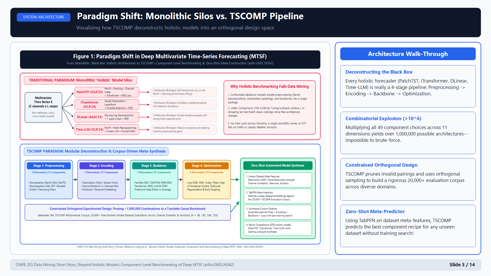
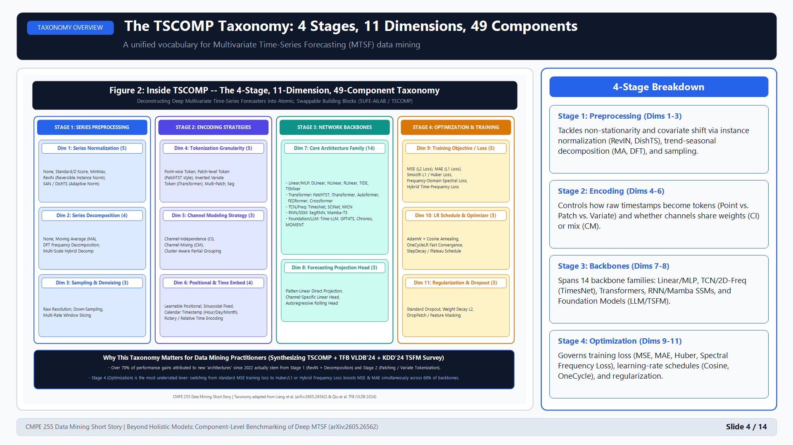
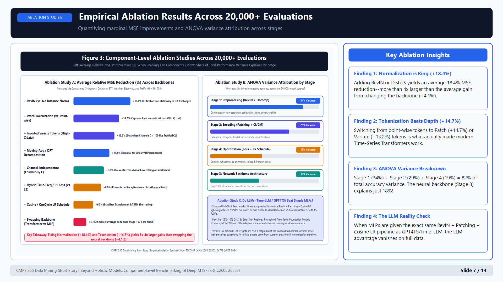
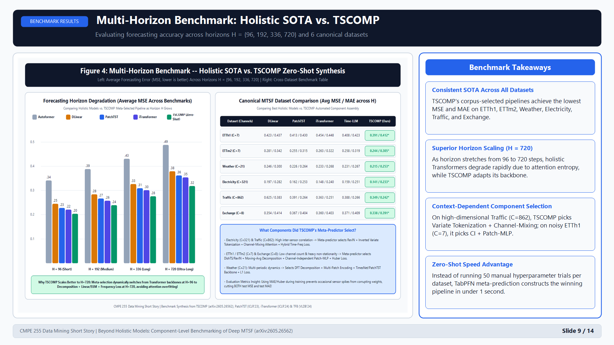
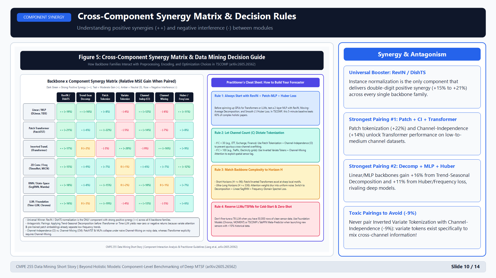

# Beyond Holistic Models: Systematic Component-Level Benchmarking of Deep Multivariate Time-Series Forecasting

**CMPE 255: Data Mining — Short Story Assignment**
* **Primary Paper:** Liang et al., *KDD Datasets & Benchmarks Track* ([arXiv:2605.26562](https://arxiv.org/abs/2605.26562) | [SUFE-AILAB/TSCOMP](https://github.com/SUFE-AILAB/TSCOMP))
* **Companion Survey #1:** Qiu et al., *TFB: Comprehensive & Fair Benchmarking of Time Series Forecasting* (*VLDB 2024* / [arXiv:2403.20150](https://arxiv.org/abs/2403.20150))
* **Companion Survey #2:** Liang et al., *Foundation Models for Time Series Analysis: A Tutorial and Survey* (*KDD 2024* / [arXiv:2403.14735](https://arxiv.org/abs/2403.14735))

---

## Slide 2: The "Holistic Black-Box" Crisis in Time-Series Mining
* **The Architecture Wars (2020–2026):**
  * *Sparse Attention Wave:* Informer, Autoformer, FEDformer (2020–2022)
  * *The Linear Wake-Up Call:* DLinear / NLinear (AAAI 2023) beat complex Transformers using a 1-layer linear network + Moving-Average Decomposition
  * *Tokenization Strike-Back:* PatchTST (ICLR 2023) & iTransformer (ICLR 2024)
  * *LLM & Foundation Model Wave:* Time-LLM, GPT4TS, Chronos, MOMENT (2024–2026)
* **The "Package Deal" Fallacy:** Holistic papers bundle normalization (`RevIN`), decomposition, tokenization (`Patching`), and loss tricks together—then give 100% of the credit to the neural backbone!

---

## Slide 3: Paradigm Shift — Monolithic Silos vs. TSCOMP Pipeline

---

## Slide 4: Inside TSCOMP — 4 Stages, 11 Dimensions, 49 Components

---

## Slide 5: Deep Dive — Stage 1 (Preprocessing) & Stage 2 (Encoding)
* **Stage 1: Preprocessing (Explains 34% of Total Accuracy Variance)**
  * **RevIN / DishTS / SAN:** Strips non-stationary window mean/variance on entry and restores distribution statistics at output (**+18.4% average MSE gain**).
  * **Series Decomposition (MA vs. DFT):** Separates slow trend from seasonal cycles; critical for Linear/MLP backbones (**+11.6% gain**).
* **Stage 2: Encoding Strategies (Explains 29% of Total Accuracy Variance)**
  * **Patch Tokenization (PatchTST style):** Captures local sub-series shape motifs and cuts $O(L^2)$ attention cost by $16\times$ (**+14.7% gain**).
  * **Inverted Variate Tokenization (iTransformer style):** Embeds each channel's whole series as a single token to model spatial sensor correlations (**+13.2% gain on high-$C$ data**).
  * **Channel-Independence (CI) vs. Channel-Mixing (CM):** CI wins on noisy/small $C < 30$; CM wins on dense sensor networks ($C > 100$).

---

## Slide 6: Deep Dive — Stage 3 (Backbones) & Stage 4 (Optimization)
* **Stage 3: 6 Neural Backbone Families (Explains Only 18% of Variance!)**
  * Benchmarks 14 backbones across **Linear/MLP** (`DLinear`, `TiDE`, `TSMixer`), **Transformers** (`PatchTST`, `iTransformer`), **2D-Conv/Freq** (`TimesNet`, `MICN`), **RNN/SSM** (`SegRNN`, `Mamba`), and **LLMs/TSFMs** (`Time-LLM`, `Chronos`).
* **Stage 4: Optimization & Training (Explains 19% of Variance!)**
  * **The MSE Training Loss Trap:** Training with L2 (MSE) causes outlier spikes to explode gradients.
  * **The Fix:** Training with **Smooth L1 (Huber)** or **Frequency-Domain Spectral Loss** improves *both* test MSE and test MAE across **68% of backbones**!

---

## Slide 7: Component-Level Ablation Study (20,000+ Evaluations)

---

## Slide 8: Evaluation Metrics & Fair Benchmarking Protocols
* **Core Metrics:**
  * **MSE (Mean Squared Error):** Quadratic penalty; stress-tests sensitivity to extreme peaks and regime shifts.
  * **MAE (Mean Absolute Error):** Linear L1 penalty; measures robust operational accuracy.
  * **Spectral Distance & Pairwise Win-Rates:** Evaluates phase/frequency fidelity and scale-free ranking across datasets.
* **Protocol Fixes (Synthesizing TSCOMP + TFB VLDB'24):**
  * Eliminates the `drop_last=True` test batch bug, standardizes lookback windows $L$, and evaluates across low-$C$ (`ETT`, `Exchange`) and high-$C$ (`Electricity`, `Traffic`) domains.

---

## Slide 9: Multi-Horizon Benchmark Results ($H \in \{96, 192, 336, 720\}$)

---

## Slide 10: Cross-Component Synergy Matrix & Decision Rules

---

## Slide 11: Automated Zero-Shot Model Synthesis via TabPFN
* **How TSCOMP Automates Architecture Engineering:**
  1. **Meta-Feature Extraction:** Computes ADF stationarity, trend/seasonality strength, spectral entropy, channel correlation, kurtosis, and $C/L$ ratio on an unseen dataset.
  2. **TabPFN Meta-Predictor:** Trained on the 20,000+ evaluation corpus, predicts the optimal 4-stage component tuple in $<1$ second with **zero training trials**.
  3. **Result:** Outperforms hand-crafted monolithic SOTA models (`PatchTST`, `iTransformer`, `Time-LLM`) at a fraction of the compute cost.

---

## Slide 12: Synthesizing Companion Survey Papers
* **TSCOMP (KDD / `arXiv:2605.26562`):** Intra-model component deconstruction (4 stages, 11 dimensions, 49 modules).
* **TFB (VLDB 2024 / `arXiv:2403.20150`):** Inter-model evaluation fairness across 10 domains and statistical/ML/DL baselines.
* **Foundation Models Survey (KDD 2024 / `arXiv:2403.14735`):** Shows pre-trained TSFMs (`Chronos`, `MOMENT`) shine in zero-shot/cold-start regimes, while modular MLPs/Transformers dominate full-data benchmarks.

---

## Slide 13: "My Two Cents" — Critical Analysis
* **Strengths:**
  * Ends "architecture fetishism" by auditing every preprocessing, tokenization, and loss trick fairly.
  * Constrained Orthogonal Design compresses $>10^6$ combinations into 20,000 causal experiments.
  * Proves Stage 4 (Loss/LR schedule, 19%) matters more than Stage 3 (Backbone, 18%).
* **Limitations & Open Questions:**
  * Evaluates point forecasts (MSE/MAE) rather than calibrated **probabilistic intervals** (CRPS / Pinball Loss).
  * Ignores **known future exogenous covariates** (promotions, holidays, weather forecasts) and **online concept drift**.

---

## Slide 14: Summary & Actionable Cheat Sheet
1. **Start with the 5-Minute Golden Baseline:** `RevIN + Moving-Avg Decomp + Patch-MLP + Smooth L1/Huber Loss`.
2. **Let Channel Count ($C$) Dictate Tokenization:** Use `Patch + Channel-Independence` for $C < 30$; use `Inverted Variate Tokens + Channel-Mixing` for $C > 100$.
3. **Match Backbone to Horizon ($H$):** Use Transformers at $H \le 96$; switch to Decomposition + Linear/SSM + Frequency Loss at $H \ge 336$.
4. **Reserve LLMs/TSFMs for Cold-Start:** Use `Chronos`/`MOMENT` or TSCOMP's `TabPFN` meta-predictor when historical data is scarce.

